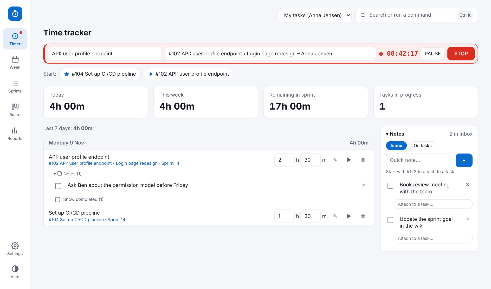
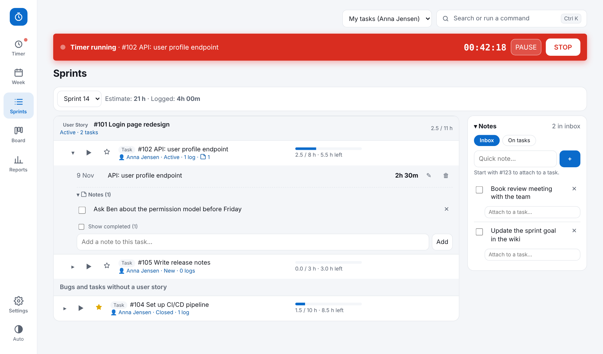
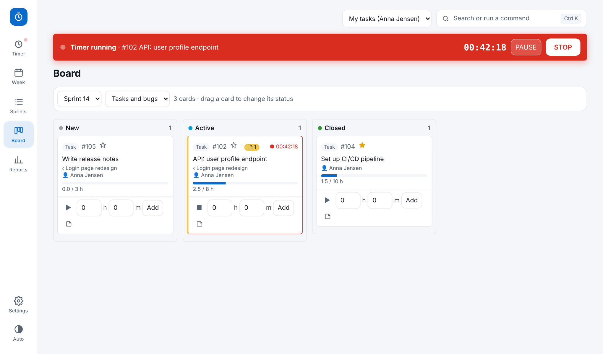
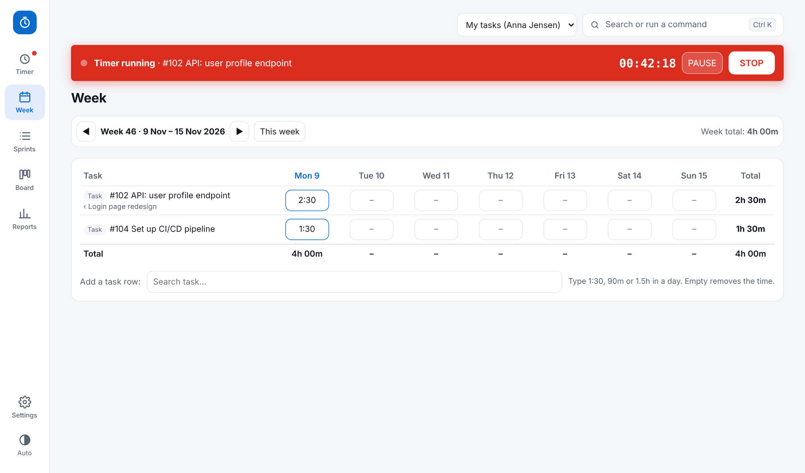
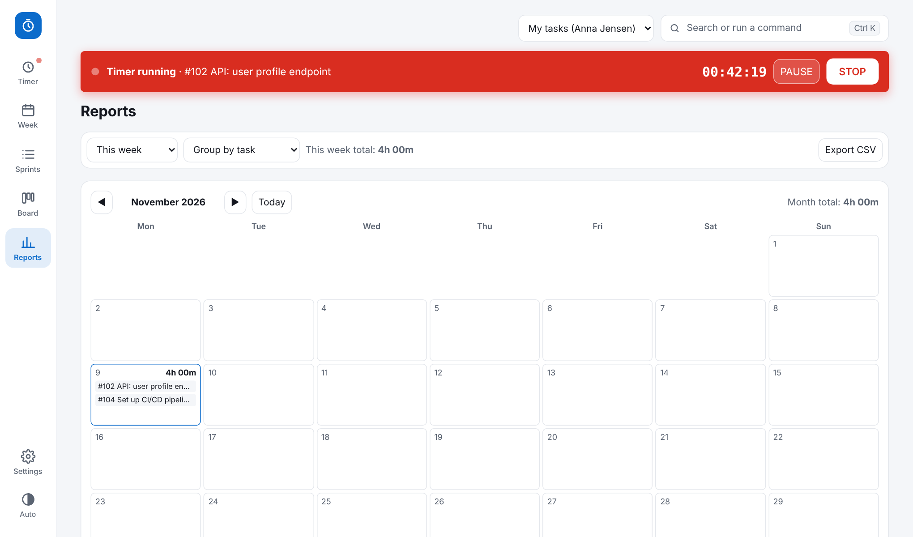
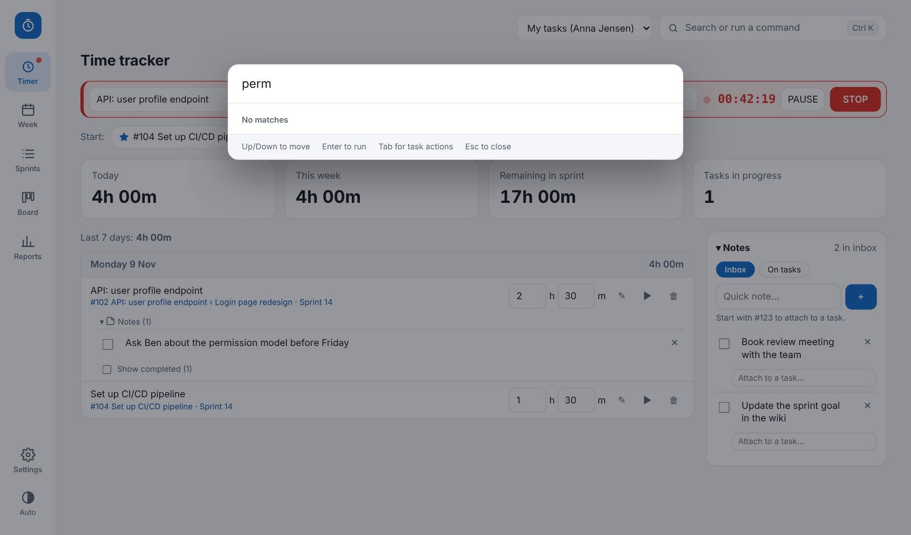
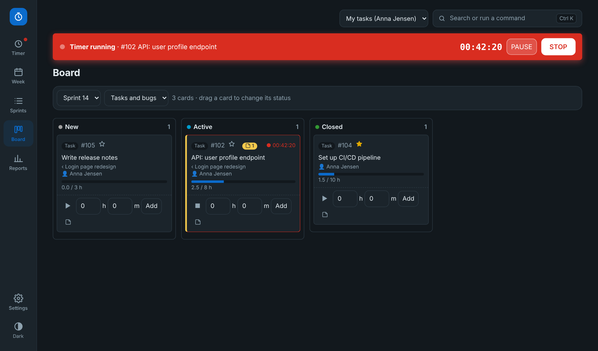

# SprintTimer

A Clockify-style time tracker built for **Azure DevOps sprints**. Log time on the Tasks and Bugs you actually work on, and SprintTimer writes it back to DevOps as *Completed Work* and *Remaining Work* — so your timesheet and your sprint board never drift apart.

## Purpose

Most teams track time twice: once in a timer app and once in Azure DevOps. SprintTimer removes the second step.

- **One place to log time**, against the real work items in your current sprint.
- **DevOps stays correct**: Original Estimate is the budget, Completed goes up and Remaining goes down every time you log, stop a timer, or edit/delete an entry.
- **Local and private**: no cloud service. Your data lives on your PC, and the only network traffic is to `dev.azure.com`.

## What it does

| | |
|---|---|
| **Timer** | Start/pause/stop a timer on any task, or add time manually in minutes. A clear running-timer bar shows on every page. |
| **Sprints** | Your sprint's tasks and bugs with budget (Original Estimate), logged, remaining and over-budget warnings. |
| **Board** | New / Active / Closed columns. Drag a card to change its DevOps state. |
| **Week** | Timesheet grid: edit hours per task per day. |
| **Reports** | Per day, week or task, with totals. |
| **Notes** | A quick Inbox plus notes attached to tasks, with done checkboxes. Type `#123 text` to attach. |
| **Command palette** | `Ctrl+K` to find a task, start a timer, add time or jump to a page. |
| **My tasks / Everyone** | Defaults to your own tasks (detected from your DevOps login); switch to see colleagues' tasks. |
| **Settings** | Toggle features on/off, pick a theme and accent colour, set up the DevOps connection. |

Only Tasks and Bugs can have time logged (bugs standalone, without a parent).

## Screenshots

| Sprints | Board |
|---|---|
|  |  |

| Week | Reports |
|---|---|
|  |  |

| Command palette | Dark theme |
|---|---|
|  |  |

## Quick start (Windows)

1. Download or clone this repo and put the folder anywhere, e.g. `C:\Tools\SprintTimer`.
2. Double-click **Start.cmd**. The browser opens at `http://localhost:8787/`. Keep the black window open; closing it stops the app.
3. Open **Settings → DevOps connection**, enter organization, project, team and a Personal Access Token (scope: *Work Items – Read & Write*), then press **Fetch sprints**.

The PAT is stored in Windows Credential Manager (`SprintTimeTracker:AzureDevOpsPAT`), never in a file. Time entries are saved in `%APPDATA%\SprintTimeTracker\data.json` — back it up if the data matters.

Want to try it without DevOps? Open `demo/timetracker.html` in a browser (demo data, stored in the browser only).

## Files

| File | Purpose |
|---|---|
| `Start.cmd` | Launcher |
| `server.ps1` | Tiny local web server and DevOps proxy |
| `index.html` | The whole app (vanilla JS, one file) |
| `demo/timetracker.html` | Standalone demo without DevOps |
| `TECHNICAL.md` | How it works in detail |
