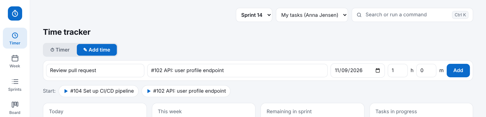
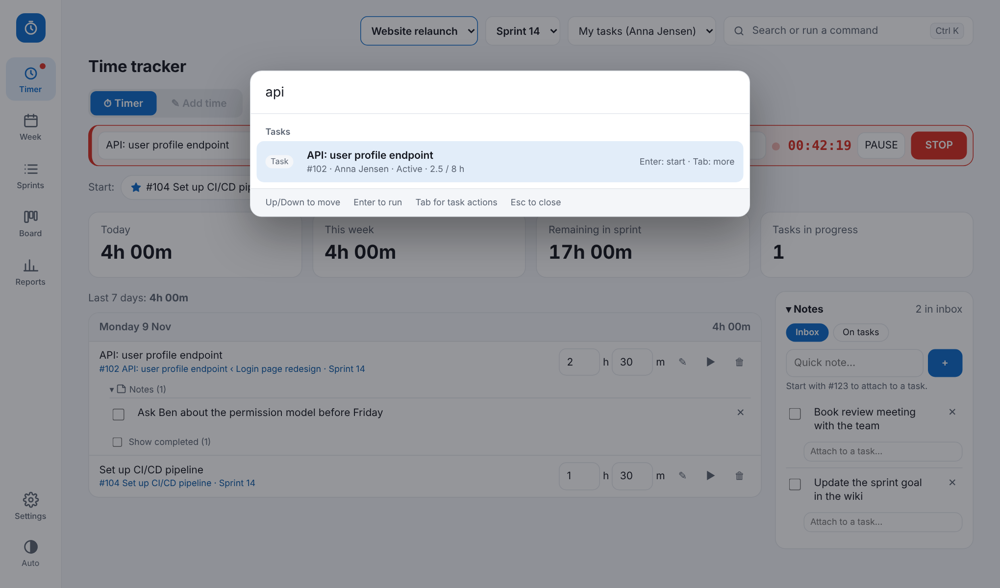

# SprintTimer

A time tracker built for **Azure DevOps sprints**. Log time on the Tasks and Bugs you actually work on, and SprintTimer writes it back to DevOps as *Completed Work* and *Remaining Work* — so your timesheet and your sprint board never drift apart.

## Purpose

Most teams track time twice: once in a timer app and once in Azure DevOps. SprintTimer removes the second step.

- **One place to log time**, against the real work items in your current sprint.
- **DevOps stays correct**: Original Estimate is the budget, Completed goes up and Remaining goes down every time you log, stop a timer, or edit/delete an entry.
- **Local and private**: no cloud service. Your data lives on your PC, and the only network traffic is to `dev.azure.com`.

## What it does

| | |
|---|---|
| **Timer** | Switch between **Timer** and **Add time** at the top of the page (Timer is the default; your task and description are kept when you switch). Start/pause/stop a timer, or add time by hand. A running-timer bar shows on every page. |
| **Compact mode** | Make the browser window small (or narrow) and only the timer is shown: clock, task, start/stop and your pinned tasks. Widen it again to get the full app back. |
| **Sprints** | Your sprint's tasks and bugs with budget (Original Estimate), logged, remaining and over-budget warnings. |
| **Board** | New / Active / Closed columns, colour-coded (grey, blue, green). Drag a card to change its DevOps state. |
| **Week** | Timesheet grid: edit hours per task per day. |
| **Reports** | Per day, week or task, with totals. |
| **Notes** | A quick Inbox plus notes attached to tasks, with done checkboxes. Type `#123 text` to attach. |
| **Command palette** | `Ctrl+K` to find a task, start a timer, add time or jump to a page. |
| **Top bar** | One place to pick the **project** (when you have saved several), the **sprint** and whose tasks to show: *My tasks* (default, detected from your DevOps login), *Everyone* or a colleague. |
| **Several projects** | Save more than one DevOps project under Settings and switch between them. Each project keeps its own tasks; your logged time is kept. |
| **Settings** | Toggle features on/off, pick a theme and accent colour, set up the DevOps connection. |

Only Tasks and Bugs can have time logged (bugs standalone, without a parent).

## Screenshots

**Add time** (switch with the tabs at the top of the Timer page):

| Sprints | Board |
|---|---|
|  |  |

| Week | Reports |
|---|---|
|  |  |

| Command palette | Dark theme |
|---|---|
|  |  |

## Quick start

**Windows**
1. Download or clone this repo and put the folder anywhere, e.g. `C:\Tools\SprintTimer`.
2. Double-click **Start.cmd**. The browser opens at `http://localhost:8787/`. Keep the black window open; closing it stops the app. (Uses Node.js if installed, otherwise the built-in PowerShell server.)

**Mac**
1. Install [Node.js](https://nodejs.org) (LTS, version 18 or newer).
2. Double-click **Start.command** (first time: right-click → Open). Or run `node server.js` in Terminal from the folder. Keep the Terminal window open while you use the app.

**Then, on both**
3. Open **Settings → DevOps connection**, enter organization, project, team and a Personal Access Token (scope: *Work Items – Read & Write*), then press **Fetch sprints**.

The PAT is stored in Windows Credential Manager or the macOS Keychain (`SprintTimeTracker:AzureDevOpsPAT`), never in a file. Time entries are saved in `%APPDATA%\SprintTimeTracker\data.json` (Windows) or `~/Library/Application Support/SprintTimeTracker/data.json` (Mac) — back it up if the data matters.

Want to try it without DevOps? Open `demo/timetracker.html` in a browser. It has demo data with two sample projects ("Website relaunch" and "Mobile app") so you can try the project switcher; everything is stored in the browser only.

## Files

| File | Purpose |
|---|---|
| `Start.cmd` / `Start.command` | Launchers for Windows / Mac |
| `server.js` | Small local web server and DevOps proxy (Node.js, no packages) |
| `cred.ps1` | Windows Credential Manager helper for `server.js` |
| `server.ps1` | Windows fallback server (PowerShell) when Node.js is not installed |
| `index.html` | The whole app (vanilla JS, one file) |
| `demo/timetracker.html` | Standalone demo without DevOps |
| `TECHNICAL.md` | How it works in detail |

## Security and privacy

- No account, no cloud: the app runs on `localhost` only and talks only to `dev.azure.com`.
- Your **Personal Access Token** is kept in Windows Credential Manager or the macOS Keychain, never in a file or in this repository. Use a PAT with the minimum scope (*Work Items – Read & Write*) and a short expiry.
- Time entries are stored locally in your user folder (see above), not in this repository.
- If a PAT is ever shared or committed by mistake, revoke it in Azure DevOps straight away.

## Contributing

This repository is published read-only. Issues and pull requests are not accepted. You are welcome to fork it under the MIT license (see `LICENSE`).
